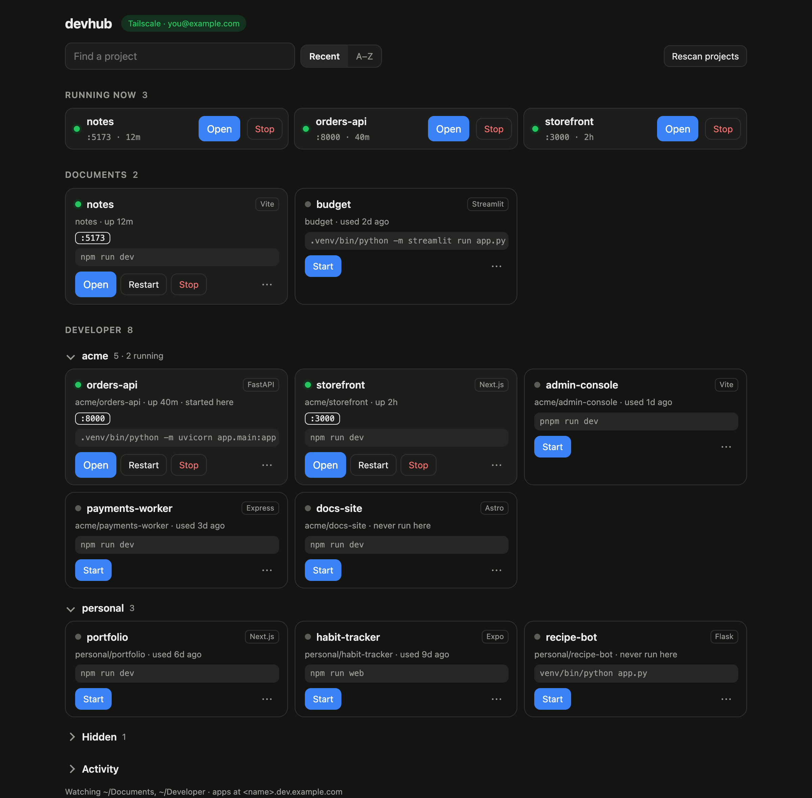
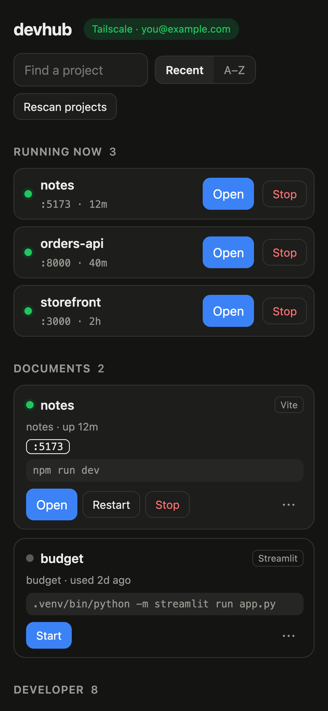

# devhub

[](https://github.com/ravingupta/devhub/actions/workflows/ci.yml)
[](LICENSE)


[](CONTRIBUTING.md)

One always-on page for every dev server on your Mac, reachable from your phone or laptop
anywhere through Tailscale.

<p align="center">
  
  &nbsp;
  
</p>

- **Sees what you run.** Start `npm run dev` or `uvicorn …` in any terminal under your project
  folders. It shows up within seconds with its folder, port and exact command. When you stop it,
  it moves to history.
- **Finds what you could run.** It scans your folders for Next/Vite/CRA/Expo/Express/FastAPI/Flask/
  Django/Streamlit projects and works out a start command for each.
- **Start / stop / restart from any device.** It replays the recorded command with the same PATH
  and virtualenv, and keeps logs for servers it started.
- **One URL per project.** You get `https://<folder>.dev.example.com/` (or `/<folder>/` on the hub)
  instead of remembering IPs and ports.
- **Organised.** Projects are grouped by root folder and parent folder. You can sort by recently
  used or A–Z, and hide projects you rarely touch.

Python standard library only. Runs as a launchd agent on macOS.

```
devhub.py        daemon: scanner, discovery, dashboard API, reverse proxy, TLS
dashboard.html   the web page
install.sh       launchd agent (start at login, auto-restart); `./install.sh uninstall`
cert.sh          Let's Encrypt wildcard certificate via DNS-01; `./cert.sh schedule` for renewals
~/.devhub/       config.json, servers.json (history), logs/, certs/, hub.log
```

## Setup

1. `./install.sh`
2. Install [Tailscale](https://tailscale.com) on the Mac and on your other devices, and sign in.
3. Pick a domain and add two DNS records pointing at the Mac's Tailscale IP (`tailscale ip -4`):
   ```
   dev.example.com      A   100.x.y.z
   *.dev.example.com    A   100.x.y.z
   ```
   On Cloudflare, set them to "DNS only". The records are useless to anyone off your tailnet.
4. Set `"domain": "dev.example.com"` in `~/.devhub/config.json` and run `./install.sh` again.
5. HTTPS (optional, recommended): put DNS API credentials in `~/.devhub/dns.env` (run
   `./cert.sh` once to see the format), then run `./cert.sh && ./cert.sh schedule`.
6. The first time you press **Start** on a project in `~/Documents`, macOS may ask whether
   python3 can access that folder. Allow it.

## Routing

| URL | Goes to |
|---|---|
| `http(s)://dev.example.com/` | dashboard |
| `http(s)://myapp.dev.example.com/` | that server (works with every framework) |
| `http(s)://myapp--5174.dev.example.com/` | another port of the same server |
| `http://<hub>/myapp/` | that server, prefix stripped (for when you have no domain) |

Path mode works around apps' absolute URLs (`/@vite/client`, `/_next/…`). It sends requests
without a prefix to the app named in the `Referer`, or else the app you opened last. Subdomains
have no such limits.

## Who can get in

- Only localhost and Tailscale addresses can connect. Everyone else is dropped before a byte is read.
- Tailscale peers are checked with `tailscale whois`. By default only devices signed into the same
  Tailscale account as this Mac are allowed. Use `"allowed_users": ["a@x.com", "b@y.com"]` to
  allow others, or `["*"]` for your whole tailnet.
- API writes need an `X-Devhub` header and a known Host. This blocks CSRF and DNS-rebinding
  attacks from pages you visit.
- Starting servers and editing commands means running commands on the Mac. Only give access to
  people you'd give a shell.

## Config (`~/.devhub/config.json`)

| key | default | |
|---|---|---|
| `roots` | `["~/Documents", "~/Developer"]` | folders to watch and scan |
| `port` / `https_port` | `80` / `443` | HTTPS turns on when `tls_cert` and `tls_key` exist |
| `domain` | `""` | enables `<name>.<domain>` routing |
| `allowed_users` | `[]` | Tailscale logins allowed in (empty = this Mac's account) |
| `poll_seconds` | `3` | how often listening ports are checked |
| `discover_minutes` | `15` | how often folders are scanned for projects (0 = off) |
| `ignore_ports`, `ignore_paths`, `ignore_commands` | | things to never list |

## CLI

```sh
python3 devhub.py list       # known servers
python3 devhub.py discover   # dry run of project discovery
tail -f ~/.devhub/hub.log    # started / stopped / discovered events
```

## Contributing

Issues and pull requests are welcome! Start with [CONTRIBUTING.md](CONTRIBUTING.md). Supporting
more frameworks in discovery and a Linux backend are good places to begin. Please follow the
[Code of Conduct](CODE_OF_CONDUCT.md), and report security issues privately as described in
[SECURITY.md](SECURITY.md).

## License

[MIT](LICENSE) © Ravin Gupta
